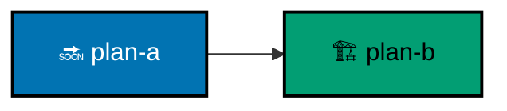

# Plan-Order Graph

A repository with more than one live plan carries a plan-order graph in `plans/README.md`: every plan in
`plans/backlog/` and `plans/in-progress/`, each dependency between them, and nothing else. A repository with one
live plan or none keeps the legend with an empty graph, so the convention stays visible where plans will appear.

## Always Updated

The graph is updated in the same change that moves, adds, or removes a plan: a promotion into `plans/in-progress/`,
an archival into `plans/done/`, a removal, or a new backlog plan. A plan move with no graph update in the same change
is a violation, and a graph naming a plan already under `plans/done/` is a violation. The graph and the latest
backlog-grooming order agree; a grooming pass that changes the order updates the graph in the same pass.

## Declarations

A plan declares its dependencies in its `README.md` as `Depends-on: [<plan-id>, ...]`, naming live plans only. A
dependency is satisfied only by its plan archived under `plans/done/`, or by it running earlier in the same scheduled
pass. Execution starts only once every declared dependency is satisfied; otherwise it stops and names the unmet one.
A missing declaration reads as no dependencies.

## Shared Legend

| Mark                | Means                                                                                  |
| ------------------- | -------------------------------------------------------------------------------------- |
| blue `#0173B2` 🔜   | backlog: planned, not started                                                           |
| teal `#029E73` 🏗️    | in progress: actively executed                                                         |
| hexagon, `infra-`   | steps only a credentialed machine performs; repositories without them list this as N/A |
| solid arrow         | hard dependency: the predecessor is done first                                         |
| dotted arrow        | soft order: the predecessor should land first, without blocking                        |

Every graph carries an `accTitle` and `accDescr`, and its `classDef` lines carry the exact fills above. Plans with no
arrow between them may run in parallel.

